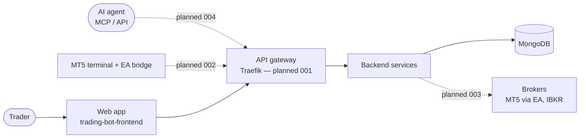
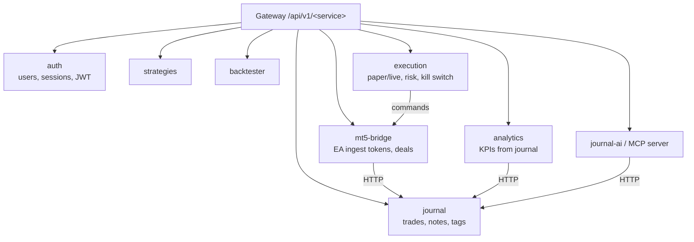

# Architecture

## 1. System context



The platform is a multi-user SaaS of trading tools. Users connect their trading accounts once; their
executions flow in automatically, get analyzed, journaled (also by AI), and can drive backtested
strategies promoted to paper and live trading.

## 2. Target containers (services)

Each box is an independently deployable service built from `services/_template` (hexagonal).
Status and ownership: [services-catalog.md](services-catalog.md).



Rules that shape this picture (details in [`.agents/rules/architecture.md`](../.agents/rules/architecture.md)):

- Inside a service: `adapters → application → domain`.
- One logical Mongo database per service; services talk over HTTP only.
- `auth` issues JWTs; services verify them locally.
- Events/queues only via ADR when needed.

## 3. Current state (legacy `app/`)

A single FastAPI app (`app/main.py`) with three routers, MongoDB database `trading_bot_db`:

| Prefix | Purpose | Notes |
|---|---|---|
| `/api/v1/auth` | Sign-up/in/out, email OTP, password reset, sessions, roles | bcrypt, HS256 JWT + `sessions` collection |
| `/api/v1/analytics` | Upload CSV/XLSX, trades, filters, KPIs, timeseries, heatmap, daily/monthly stats | Reads the **latest file in `data/raw/`** — not per user |
| `/api/v1/mt5` | MT5 accounts CRUD, sync, status, rates | Uses `MetaTrader5` package when present, **otherwise simulated data**; XOR password storage |

Legacy collections: `users`, `sessions`, `verifications`, `accounts` (OAuth placeholder), `mt5_accounts`.

### Report ingestion (kept as domain knowledge for the journal service)

MT5 exports put metadata rows before the table and repeat column names for entry/exit values.

```python
# Find the header row: first row containing both "time" and "symbol" (case-insensitive)
# Normalize duplicates: Time → open_time, Time.1 → close_time, Price → open_price,
# Price.1 → close_price, Profit/Ganancias → profit_usd, Type/Tipo → order_type
# Drop non-trade rows (deposits/withdrawals)
```

### Analytics algorithms (kept)

- Win rate, profit factor (gross profit / gross loss), payoff ratio (avg win / avg loss).
- Drawdown from the cumulative equity curve (peak-to-trough, absolute and %).
- Streaks via vectorized sign changes:

```python
df["sign"] = np.sign(df["profit_usd"])
df["streak_group"] = (df["sign"] != df["sign"].shift()).cumsum()
```

- Hourly heatmap, daily/monthly aggregates, per-symbol stats.

## 4. Migration path

| Step | Spec |
|---|---|
| `libs/shared`, service template, agent rules | 000 (done in `feat/agents-foundation`) |
| Gateway + compose, `auth`, `journal`, `analytics` services; security debt fixed; `app/` retired | 001 (`auth`, `journal`, `analytics` built, in progress; gateway, compose and `app/` retirement pending) |
| `mt5-bridge` + MQL5 EA; automatic sync into `journal` | 002 |
| `strategies`, `backtester`, `execution` (paper → live) | 003 |
| AI-filled journal via MCP/API | 004 |
