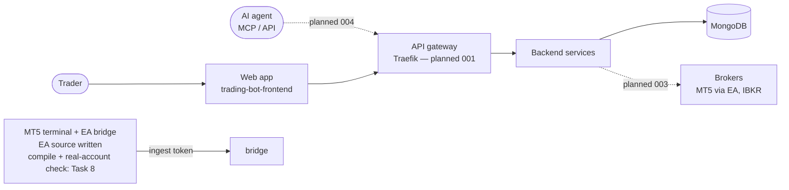
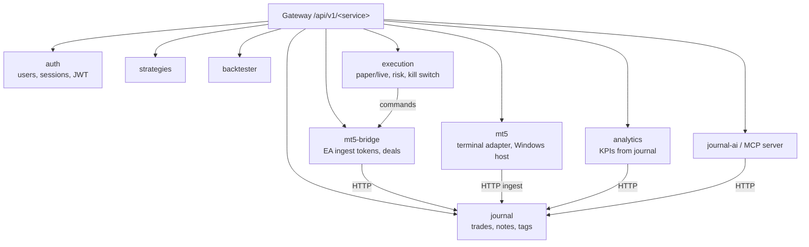

# Architecture

## 1. System context



The platform is a multi-user SaaS of trading tools. Users connect their trading accounts once; their
executions flow in automatically, get analyzed, journaled (also by AI), and can drive backtested
strategies promoted to paper and live trading.

### EA bridge flow (spec 002)

```
EA (MT5 terminal) --Bearer ingest token--> mt5-bridge --X-Service-Key--> journal
  POST /ingest/heartbeat                    resolves owner from the token   POST /ingest/deals
  POST /ingest/deals (<= 200 deals)         forwards deals, touches        stores raw deals, pairs by position_id,
                                            last_deal_at of an existing    upserts trades (idempotent)
                                            account
```

**One path per account.** The old `mt5` service and the EA push both upsert the same trade document
under `(user_id, account_ref, position_id)`; `source` stays `mt5`, the last writer wins, and they
format times (DST-aware zone vs one current offset) and prices slightly differently. If both run,
the `mt5` service's times win only until the next EA push of that position.

**Journal ingest trust.** `/api/v1/journal/ingest/*` is guarded only by `INGEST_SERVICE_KEY`: anyone
holding the key can write any user's journal, so the planned gateway must never route it publicly.

Only the heartbeat creates or updates an account (balance, equity, status); deals never create one.

The user creates a token in the web app (`POST /api/v1/mt5-bridge/tokens`, plaintext shown once) and
pastes it into the EA. Retry rule for the EA on `/ingest/deals`: 2xx accepted; 401 token unknown or
revoked (stop sending, keep the queue, ask for a new token); 503 `JOURNAL_UNAVAILABLE`, any other 5xx,
408, 429 and network errors or timeouts keep the batch and retry with exponential backoff capped at
5 minutes; 3xx keeps the batch and logs "set ApiUrl to the final https origin"; any other 4xx
(422 `VALIDATION_ERROR`, `INVALID_DEAL_BATCH`, `JOURNAL_REJECTED`) the batch can never be accepted,
drop it and log. The EA sends a heartbeat in `OnInit` before any backfill, because `last_deal_at` only
updates accounts that already exist. The EA source is `services/mt5-bridge/ea/TradingJournalBridge.mq5` (file queue, backoff capped at
5 minutes, heartbeat every 60 s, see its README) *(awaiting compile and real-account verification, Task 8)*. Acceptance:
`tests/acceptance_services/test_ea_bridge_flow.py`.

## 2. Target containers (services)

Each box is an independently deployable service built from `services/_template` (hexagonal).
Status and ownership: [services-catalog.md](services-catalog.md).



Rules that shape this picture (details in [`.agents/rules/architecture.md`](../.agents/rules/architecture.md)):

- Inside a service: `adapters → application → domain`.
- One logical Mongo database per service; services talk over HTTP only.
- `auth` issues JWTs; services verify them locally.
- Events/queues only via ADR when needed.

## 3. Current state (services)

The legacy monolith `app/` is **retired** (spec 001). Four services plus `libs/shared` run today; each has its own database:

| Service | Port | Database | Purpose |
|---|---|---|---|
| `auth` | 8001 | `auth_db` | Sign-up/in/out, email OTP, password reset, roles, JWT issuing |
| `journal` | 8002 | `journal_db` | Per-user trades and balance events; report upload and parsing; MT5 ingest |
| `analytics` | 8003 | none (stateless) | KPIs, equity, drawdown, daily/monthly/symbol/hourly stats from the journal API |
| `mt5` | 8004 | `mt5_db` | Attaches to the open MT5 terminal (Windows host): link, status, sync, candles |

Details: [services-catalog.md](services-catalog.md). Services verify JWTs locally; only `auth` signs them.

### Report ingestion (kept as domain knowledge for the journal service)

MT5 exports put metadata rows before the table and repeat column names for entry/exit values.

```python
# Find the header row: first row containing both "time" and "symbol" (case-insensitive)
# Normalize duplicates: Time → open_time, Time.1 → close_time, Price → open_price,
# Price.1 → close_price, Profit/Ganancias → profit_usd, Type/Tipo → order_type
# Drop non-trade rows (deposits/withdrawals)
```

### Analytics algorithms (kept)

- Win rate, profit factor (gross profit / gross loss), payoff ratio (avg win / avg loss).
- Drawdown from the cumulative equity curve (peak-to-trough, absolute and %).
- Streaks via vectorized sign changes:

```python
df["sign"] = np.sign(df["profit_usd"])
df["streak_group"] = (df["sign"] != df["sign"].shift()).cumsum()
```

- Hourly heatmap, daily/monthly aggregates, per-symbol stats.

## 4. Migration path

| Step | Spec |
|---|---|
| `libs/shared`, service template, agent rules | 000 (done in `feat/agents-foundation`) |
| `auth`, `journal`, `analytics` services; security debt fixed; `app/` retired | 001 (done) |
| `mt5` service (terminal adapter, [ADR 0004](adr/0004-mt5-terminal-adapter.md)) | 001 (done) |
| `mt5-bridge` + MQL5 EA; automatic sync into `journal` | 002 |
| `strategies`, `backtester`, `execution` (paper → live) | 003 |
| AI-filled journal via MCP/API | 004 |
